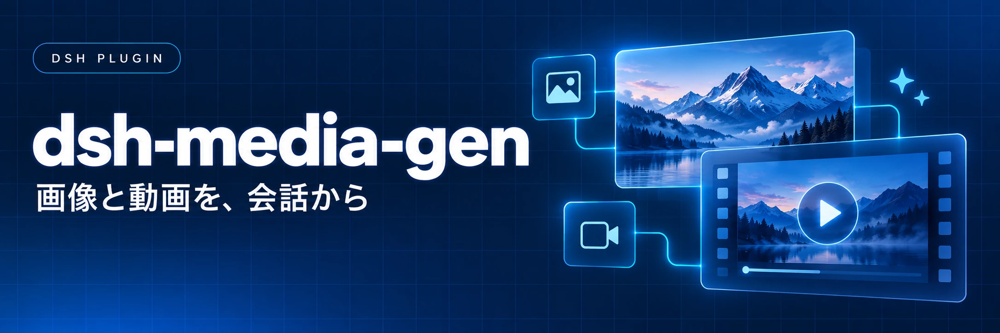
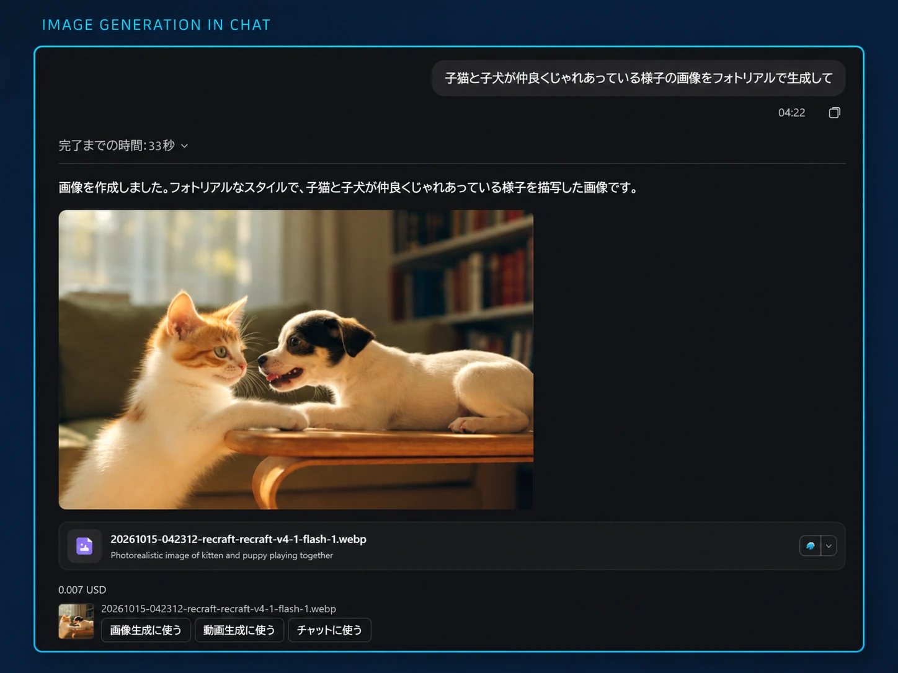

<p align="center">
  
</p>

# dsh-media-gen

[English](README.md) | [日本語](README.ja.md)

DeepSeek Harness（DSH）で画像・動画を生成するプラグインです。DSH に設定済みの OpenRouter プロバイダーと API キーを使います。**OpenRouter のみ対応しています。**

## 機能

- エージェントにモデル向けのプロンプトを作らせる方法と、生成カードやコマンドから入力文をそのまま送る方法に対応。
- 会話ごとのモデル選択、入力画像の使用、生成画像を使った画像・動画生成。
- 結果を作業ディレクトリ内（既定は `generated-media/`）へ保存。動画はバックグラウンドで生成し、依頼したセッションに通知。
- 画面は英語・日本語に対応。コマンドの応答は英語です。

## 対応バージョン

[GitHub Releases](https://github.com/so16tm/dsh-media-gen/releases) から、使用する DSH に対応した版を選んでください。対応情報と変更点は [CHANGELOG.md](CHANGELOG.md) に記録しています。

## インストール

`<tag>` を選んだリリースの完全なタグ名に置き換えて実行します。

```sh
dsh plugin --profile web add 'git+https://github.com/so16tm/dsh-media-gen.git#<tag>'
```

ビルド済みファイルを含むため、ローカルでのビルドは不要です。非公開リポジトリなので、アクセス権のある GitHub アカウントで git の認証を設定してください。別のプロファイルを使う場合は `web` を置き換えます。

更新時は新しいタグで同じ `add` を実行し、DSH を再起動します。タグなしでは未リリースの変更を含む最新の `main` が入るため、特定の版を入れ直すときもタグを指定してください。

削除するときは次を実行します。

```sh
dsh plugin --profile web remove dsh-media-gen
```

削除後も DSH を再起動してください。

DSH の Models 設定に OpenRouter プロバイダーを追加し、API キーを保存します。

## 使い方

<p align="center">
  
</p>

*チャットで依頼し、生成した画像を次の画像・動画生成に使う例。提供されたスクリーンショットを掲載用に加工しています。表示料金はこの例での金額です。*

### 生成カードとチャット

チャット欄の「生成…」からカードを開き、画像・動画、モデル、内容、モデルが対応する生成オプションを選びます。

- 「エージェントに頼む」では、エージェントがプロンプトの作成・翻訳や不足情報の確認を行います。
- 「そのまま生成」では、入力文を変更せず送信し、課金を伴う生成を開始します。表示された概算料金を先に確認してください。

チャットから直接依頼することもできます。異なる画像を複数作る場合は、1 枚ごとのプロンプトで依頼します。`/image --count` は同じプロンプトを繰り返します。

生成画像は DSH のファイルプレビューで開けます。「画像生成に使う」「動画生成に使う」は画像を入力にしたカードを開きます（動画では最初のフレーム）。「チャットに使う」は画像のパスを入力し、現在の下書きを置き換えます。

必要なら、モデルごとの書き方メモをエージェントに保存させられます。メモは再起動後も残り、すべての会話に適用されるため、保存・削除には必ず承認を求めます。

### コマンド

オプションはプロンプトの前に置き、空白を含むパスは `"` で囲みます。

| 入力 | 内容 |
|---|---|
| `/image [--model id] [--aspect 1:1] [--resolution 1K] [--count n] [--seed n] [--image path]... [--yes] <prompt>` | 画像を生成。入力画像は `--image` を繰り返して指定 |
| `/video [--model id] [--duration seconds] [--aspect 16:9] [--resolution 720p] [--audio on\|off] [--seed n] [--first path] [--last path] [--ref path]... [--yes] <prompt>` | 動画ジョブを登録。最初・最後のフレームと参照画像を指定可能 |
| `/media-jobs [job-id]` | このセッションの動画ジョブ一覧、または指定ジョブの即時確認 |
| `/media-model` | 選択中のモデルと既定値を表示 |
| `/media-model image` | 画像モデルの ID を一覧 |
| `/media-model image <model-id> [provider]` | この会話のモデルを選択 |
| `/media-model image default` | 会話の選択を解除 |
| `/media-approval on` | この会話で通常の生成ごとの確認を省略 |
| `/media-approval off` | 通常の生成ごとの確認に戻す |

動画モデルの選択は `image` を `video` に置き換えます。チャット欄の選択欄も同じ操作で、選択は再起動後も残ります。エージェントは自身の指定より会話のモデル選択を優先し、モデル指定がない場合は設定の既定値を使います。会話の選択がある状態でカードから別のモデルを選び「エージェントに頼む」を押すと、その選択も更新します。

### 承認と料金

生成には料金がかかります。`requireApproval` が有効で会話単位の許可がない場合、エージェント経由では実際のプロンプトと概算料金を示して承認を求めます。直接コマンドは `--yes` を付けるまで概算だけを返します。会話単位の許可は、チャット欄の「画像・動画 → 生成前の確認」でも切り替えられ、ユーザーだけが変更できます。

エージェントのツールは、作業ディレクトリ外の画像の送信と、同じターンでの 2 回目以降の生成では必ず確認します。通常の確認を無効にしても省略できません。ユーザーの発言ではなく、サブエージェントの報告や動画の完了通知で始まったターンでは生成できません。DSH はサブエージェントの承認の問い合わせをユーザーに見せずに拒否するため、サブエージェントが生成できるのは、会話で確認なしの生成を許可しているとき（または `requireApproval` がオフのとき）だけです。サブエージェントに量産を任せるときは、会話で許可してください。この場合も、作業ディレクトリ外の入力画像は断ります。直接コマンドは `requireApproval`、`--yes`、会話単位の許可に従い、この追加確認は適用されません。

概算が不明になる場合や、入力画像・トークン料金などにより実際より安く出る場合があります。承認が必要なエージェント経由の生成では、概算できなくても確認を求めます。タイムアウトや利用できない応答の後も課金済みの可能性があるため、再試行前に確認してください。複数画像の途中で失敗した場合は、保存済み画像と失敗を返します。

### 動画ジョブ

ストレージを利用できる場合、DSH の再起動後もジョブの追跡を再開します。完成すると自動で保存し、完了・失敗・期限切れをセッションが開いているときに通知します。`/video` の完了ではエージェントを起動しないため、`/media-jobs` で確認するか次のターンを待ちます。

`videoMaxWatchMs`（既定は 3 時間）を過ぎると追跡を止めます。プロバイダーのジョブ取り消しや返金を意味するものではありません。エージェントに `media_video_status` へ `job_id` を渡して確認させると、追跡を再開できます。

## 設定

「プラグイン → メディア生成 → コンポーネント → メディア生成 >」から、既定モデル、チャット欄に出すモデル、上限、承認、通知を設定します。「すべてのモデル…」では絞り込み対象外のモデルも選べ、エージェントも全モデルを一覧できます。

| 項目 | 既定値 | 内容 |
|---|---|---|
| `defaultImageProvider` / `defaultImageModel` | なし | 既定の画像プロバイダー・モデル ID |
| `defaultVideoProvider` / `defaultVideoModel` | なし | 既定の動画プロバイダー・モデル ID |
| `chatImageModels` / `chatVideoModels` | `[]` | チャット欄のモデル ID。空なら全モデル |
| `maxImagesPerCall` | 4 | 1 回あたりの最大枚数 |
| `maxVideoSeconds` | 10 | 動画の最大秒数。「制限事項」も参照 |
| `requireApproval` | true | 通常の生成ごとの確認 |
| `outputDir` | `generated-media` | 作業ディレクトリ内に収まる相対保存先 |
| `notifyOnVideoCompletion` | true | 動画ジョブ終了時にセッションへ通知 |

状態確認・追跡期間・タイムアウト・キャッシュ・受信サイズの詳細設定は[設定スキーマ](src/index.ts)を参照してください。

## 制限事項

- 入力画像は OpenRouter へ送信します。PNG・JPEG・WebP・GIF の 20 MiB 以下で、モデルが指定の入力画像・フレームに対応している必要があります。API キーはブラウザーに渡しません。
- 保存先に `Pictures` のような一般的な名前を使わないでください。過去の出力を表示するため、画像の配信経路は同じ保存先フォルダー名の画像も扱い、作業ディレクトリを区別しません。
- 動画プレビューは mp4・m4v・webm・mov の 32 MiB 以下です。ダウンロードの上限とは異なります。
- 秒数を省略した動画に `maxVideoSeconds` を適用できるのは、モデル一覧に対応する秒数がある場合だけです。
- DSH のストレージが使えない場合、再起動後は動画を追跡できません。

## 開発

clone 後に実行します。

```sh
pnpm install --frozen-lockfile
pnpm check
```

`pnpm check` は型チェック、ビルド、テスト、CHANGELOG の検証を行います。ローカル版を使うには次を実行します。

```sh
dsh plugin --profile web add <absolute-path-to-clone>
```

`src/` を編集したら `pnpm build` を実行し、生成した `lib/` も一緒にコミットします。使い方の変更は README の両言語版へ反映し、リリースと対応情報は [CHANGELOG.md](CHANGELOG.md) に記録してください。

## ライセンス

[package.json](package.json) では MIT ライセンスを宣言しています。
